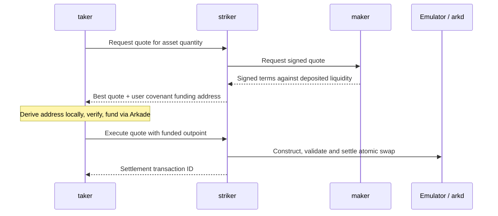

# TypeScript service PoC

This PoC trades a Striker BTC liquidity deposit against a Banco-style user offer
selling an Arkade test asset for BTC. Three independently runnable TypeScript
projects implement the maker, router/executor, and user. The shared covenant byte
format remains the reference for a later Rust implementation.

## Projects and communication

| Project | Executable | Owns |
|---|---|---|
| `apps/striker` | `striker` | Maker endpoint configuration, quote selection, transaction construction and submission |
| `apps/maker` | `maker` | Maker private key, liquidity deposit, pricing and quote signatures |
| `apps/taker` | `taker` | Taker private key, quote selection request, funding and swap execution request |
| `packages/protocol` | Library only | Covenant scripts, signed quote encoding, HTTP types and Arkade adapters |



There is **no maker–taker transport**. Only Striker knows maker endpoint URLs;
the taker receives public signed terms, never a maker URL. Maker quoting receives
only the asset and amount, not the taker's identity. Wallets use Arkade directly
to deposit/fund, but requests for quotes and swap execution go through Striker.
Striker holds neither actor's private key. A maker can go offline after quoting.

Each app has its own `package.json`, build configuration, and executable wrapper.
They share one npm workspace lockfile. Build output is regular Node JavaScript;
these are executable TypeScript projects, not native Rust binaries yet.

## Run

Requires Node 22+ and Docker with Compose. The regtest stack downloads several
images and needs a few minutes on first boot. Default ports include 7070 (arkd),
7073 (Emulator), and 3000 (Esplora); change `.env.regtest` and the test endpoint
environment variables together if these ports are occupied.

```sh
npm ci
npm run build
npm run check
npm test
npm run demo
npm run regtest -- start
npm run test:e2e
npm run regtest -- stop
```

`scripts/regtest.mjs` clones ArkLabsHQ/arkade-regtest into ignored `.cache/`, pinned
to `9ac38fe94585bf99a65581d2e79eda63c7e61b6b`. Its `emulator` profile brings up
the base Bitcoin/indexer services, arkd, and the Emulator. The Compose project
and container prefix are isolated as `striker-poc`; block production is manual.
This project's overrides use consistent seconds-based locktimes and a one-day
VTXO expiry so the CLI faucet stays usable between test runs. Stop preserves
test volumes. Restarting the stack replenishes its CLI faucet.

The fast tests check the wire format and transaction construction. Only the E2E
suite exercises actual covenant validation and settlement; fast tests passing
alone do **not** establish that the script works. `processes.test.ts` launches
the compiled executables as separate OS processes, selects between two makers,
stops both makers, and executes from the taker through Striker. It also tests
rejection of a modified funding address and duplicate execution requests.

## Run the three projects manually

Run from the repository root after building and starting regtest. Use separate
terminals for the three roles. Keep each actor's original private key when
restarting it. Amounts below are integer atomic units, not display-token amounts.

First prepare the taker's test wallet and mint an asset:

```sh
export TAKER_PRIVATE_KEY="$(node -e 'process.stdout.write(require("node:crypto").randomBytes(32).toString("hex"))')"
npm run taker -- address
npm run regtest -- ark send --to <taker-address-from-output> --amount 1000000 --password secret
npm run taker -- issue --amount 20000
```

Copy the issued `assetId`. In the maker terminal, create liquidity and start quoting:

```sh
export MAKER_PRIVATE_KEY="$(node -e 'process.stdout.write(require("node:crypto").randomBytes(32).toString("hex"))')"
npm run maker -- address
npm run regtest -- ark send --to <maker-address-from-output> --amount 1000000 --password secret
npm run maker -- deposit --asset-id <assetId> --sats 100000 --rate-numerator 5 --rate-denominator 1 --state .cache/maker.json
npm run maker -- serve --state .cache/maker.json --port 4101
```

The configured rate offers five BTC sats per asset atomic unit. The public state
file records the original deposit and rate; the signing key stays in the maker's
environment. The maker reads the live deposit tip and epoch for every RFQ.

In the Striker terminal, configure the maker endpoints (comma-separated for several):

```sh
npm run striker -- serve --makers http://127.0.0.1:4101 --port 4100
```

Back in the taker terminal, request and execute an offer:

```sh
npm run taker -- quote --striker http://127.0.0.1:4100 --asset-id <assetId> --give-amount 2000 --out .cache/quote.json
npm run taker -- execute --quote .cache/quote.json
npm run taker -- status --striker http://127.0.0.1:4100 --quote-id <quoteId-from-output>
```

Execute within the quote's deadline (default 30 seconds). The taker authenticates
the maker signature and derives the user covenant locally before funding it. The
quote file records the funding transaction before requesting execution, and a
repeated execution request returns the settled transaction while Striker remains
running. The funding submission and local file write are not an atomic operation:
after a process crash at that boundary, inspect the wallet before retrying.

The npm-installed executable aliases are also available as `npm exec -- maker`,
`npm exec -- striker`, and `npm exec -- taker` after `npm ci` and building.

## HTTP boundary

All servers bind `127.0.0.1` by default. Request amounts and epochs are decimal
strings; bytes are lowercase hex. The existing signed quote bytes are unchanged.

| Service | Endpoint | Purpose |
|---|---|---|
| Maker | `POST /v1/quotes` | Receive asset/amount from Striker; return a signed quote |
| Striker | `POST /v1/quotes` | Poll configured makers, validate live liquidity, choose most BTC for the same asset amount |
| Striker | `POST /v1/swaps` | Receive quote ID and funding txid/vout; reconstruct, validate, and settle |
| Striker | `GET /v1/swaps/:quoteId` | Return execution status and settled txid |
| Both servers | `GET /health` | Report process liveness |

Striker stores quotes and execution status in memory. It rechecks the maker tip,
epoch, deadline, user covenant, and exact funding asset/quantity before execution.
Concurrent duplicate requests are refused; completed duplicates return the same
txid. A failed submission is held as failed rather than automatically resubmitted,
because a network error may occur after settlement. Status is lost on restart;
durable execution records and recovery are future work.

## First transaction

Inputs:

- A maker BTC covenant deposit with its epoch in an extension packet.
- A user covenant holding exactly the asset quantity offered for the swap.

Outputs:

0. Exactly the quoted BTC to the user. Banco's full-fill BTC predicate enforces
   the user's destination and minimum amount.
1. Remaining BTC to the maker's identical covenant address.
2. The quoted Arkade asset to the maker's fixed destination, carrying the user's
   input satoshis.
3. One extension containing asset accounting, both covenant witnesses, and epoch.
4. The SDK's zero-value ephemeral anchor.

The maker witness is `[BIP340 signature, encoded quote]`. The covenant verifies
the signature, parses those same signed bytes, checks the deadline against the
Emulator clock, checks the prior and new epoch packets, and checks the outputs.
Neither owner signs a fill. Both trees also have an immediate owner + arkd
tapscript leaf for cooperative withdrawal/refund. Cancellation uses that leaf
to recreate the maker deposit with epoch incremented; the covenant fill path
cannot change the epoch.

The E2E suite tests expired quotes, wrong epochs, forged signatures, diverted
payments/change, and underpayments that preserve transaction accounting. It then
tests repeated fills, a new signed price against the existing deposit, an epoch
bump, a fresh-epoch fill, refund, and withdrawal.
Each rejected fill must produce a new covenant execution failure in the local
Emulator container's logs, at the expected input. Emulator v0.0.8 hides the actual
failure behind an HTTP `internal error`, so HTTP rejection alone is insufficient.
These assertions require Docker log access (`EMULATOR_CONTAINER` defaults to
`striker-poc-emulator`) and exclusive use of that Emulator during the test.

## Wire format and Rust port

`vectors/quote-v0.json` contains deterministic quote bytes, digest, signature,
covenant bytes/ASM, scriptPubKeys, and an unsigned synthetic settlement PSBT.
These are conformance vectors, not a funded transaction. The fixture keys are
public test keys. To intentionally regenerate after a protocol change:

```sh
npm run demo -- --write-vector
```

The signed message is the concatenation of:

| Field | Encoding |
|---|---|
| Domain/version | UTF-8 `striker/quote/v0` followed by a zero byte |
| Lineage | 32 opaque bytes |
| Wanted asset | 34-byte SDK AssetId (display-order txid + u16 LE group) |
| Maker destination | 34-byte P2TR scriptPubKey |
| BTC sats X | 8-byte unsigned LE, 1..2^63-1 |
| Asset units Y | 8-byte unsigned LE, 1..2^63-1 |
| Epoch | 8-byte unsigned LE, 0..2^63-1 |
| Deadline | 8-byte unsigned LE Unix seconds, 0..2^63-1 |

BIP340 signs SHA256 of that whole message. Fixed widths avoid concatenation
ambiguity, and the integer cap aligns positive u64 LE with the VM's fixed-width
sign-magnitude integers. Asset introspection takes the txid in reversed byte
order; the wire quote retains SDK serialization order. The experimental epoch
packet tag is `0x7e`, containing eight LE bytes. It is transaction-wide in this PoC.

Port `packages/protocol/src/{quote,covenant,settlement}.ts` to Rust against the same
vectors, then implement the three executables against the documented HTTP
boundary. Keep the TypeScript E2E driver initially. Prove byte equality and run
the same adversarial scenarios before replacing the driver. No independent
Script VM is implemented here.

## Boundaries

- One BTC maker deposit and one asset user offer per settlement. Striker selects
  among several makers, but does not aggregate deposits, route multiple hops,
  or charge service fees. Maker prices are configured integer fractions.
- The services are a local regtest PoC with in-memory orders and no durable
  execution recovery. Deposit tracking requires exactly one live tip at its
  script; full original-outpoint lineage traversal remains future work. Maker
  cancellation/withdrawal and taker refund are tested at the covenant level;
  their management commands are not yet exposed by these CLIs.
- The recursive BTC remainder must be at least 330 sats; final deposit exhaustion
  is deferred. Asset liquidity deposits require separate asset balance accounting:
  an asset quantity is **not** the VTXO's native BTC value.
- Banco compatibility means composition with its reproduced **full-fill BTC
  predicate**, not compatibility with every Banco SDK, TLV format, or partial-fill
  contract. The PoC has its own tree and immediate cancellation behavior.
- Expiry is enforced when the Emulator validates. This does not prove that a
  previously co-signed transaction cannot settle after the deadline.
- The stack's single-spend rule prevents concurrent spends; quotes reserve no
  liquidity. This suite does not yet stress competing fills or refund races.
- Owner paths still require arkd. These PoC trees have no unilateral L1 exit
  leaf and must not be used with real funds. Exit construction and recovery are
  separate work before production.
- Epoch storage and fixed output slots must be redesigned for multiple makers
  in one transaction. The epoch packet tag is experimental, not registered.

References: [Arkade regtest](https://github.com/ArkLabsHQ/arkade-regtest),
[Banco predicate](https://github.com/arkade-os/banco/blob/master/src/offer.ts),
[Emulator](https://github.com/arkade-os/emulator).
